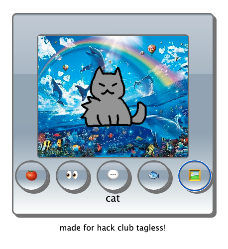

# Virtual Cat
Play with a virtual cat pet in a small frutiger-aero style influenced website.
Built without tags, for Hack Club Tagless.

## Demo
You can try out the website [here](https://tagless-cat.vercel.app/).

## Features
- A cat virtual pet
- Ability to name your cat
- Ability to interact with buttons and user click to change animations
- Change the background of the widget

## How to play
- Click the cat to pet (and it will meow)
- Click the text speech button to ask it for some advice...
- Click the tomato button to throw a tomato at it
- Click the fish button to feed the fish
- Click the picture button to change the background
- Click the look button for a fun animation

## Future features + fixes
- Prevent other animations from overlapping and bugging each other out </3

## License
This code is open-sourced under the MIT License.
